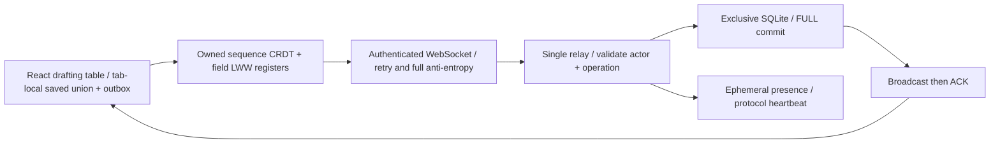

# Loom

Loom keeps a shared text draft and canvas convergent while participants edit concurrently, go offline, and reconnect.

## Result

**80/80 seeded trials converged**, across 160,000 generated operations and 306,748 initially dropped deliveries; eventual anti-entropy restored the complete union.  
Actual durable loopback WebSockets, 3 Node clients / 300 sequential offers: **p50 2.576 ms, p99 5.569 ms** until both other replicas applied the operation; polling resolution disclosed below.  
Randomized campaign: **2,000 operations/trial**, 4 replicas; duplicate/reordered text operations and LWW canvas fields agree. [Raw output](docs/results/benchmark.json). Human collaboration benefit: **not measured**.

## Architecture



## Run it

Node with npm is the prerequisite; the supported CI/runtime line is Node 22. Built-in SQLite is experimental on the measured local Node runtime; no database account or model download is required.

```sh
make demo
# Open http://127.0.0.1:8097 · local-edit / local-view · Ctrl-C stops the relay.
make lint test bench
```

[Demo, second participant and real recording steps](docs/DEMO.md). Open another browser profile/context for an independent participant; a cloned tab can copy its session actor and is deliberately rejected. **Not deployed.**

## Decisions and limits

- Own RGA-style character tree, permanent tombstones, deterministic Lamport/actor ordering and per-field LWW canvas registers. Unknown anchors/deletes wait safely for their referenced insertions. This is not Yjs/Automerge, a production Unicode/IME editor, rich text, undo or intention-preservation proof. [Design](docs/DESIGN.md), [ADRs](docs/adr/).
- Convergence requires unique actors, nonconflicting IDs, operation capacity and eventual delivery. Permanent partitions cannot converge. The finite seeded campaign is evidence, not a universal proof. No tombstone garbage collection; the operation budget is explicit and exhaustion rejects rather than drops edits silently.
- A real browser test caught deletion of an unseen remote insertion while a focused draft was being edited. Edits now use the character IDs actually displayed; leaving the field reveals the merged view. The original [failing run](docs/results/caught-focused-draft.log) is retained.
- SQLite's exclusive locking mode fences a second relay; FULL transactions commit before broadcast/ACK. Actual process-kill/restart proof is retained. This is single-process local-disk persistence, not HA, power-loss validation or multi-host coordination. [Quality report](docs/QUALITY.md).
- Browser operations/outbox are saved locally; credentials remain in memory. Storage-full/quota/cleared-browser failures are explicit limitations. ACK means relay committed that ID, not every participant acknowledged it. Snapshot exchange sends the full retained union, not a vector-clock optimization.
- Text edits use one contiguous code-point diff of the displayed draft. Canvas text is a whole-field LWW register: concurrent same-field values can lose by the documented tie-break. Presence is ephemeral, not persisted identity or shared selections. Shared edit/view tokens are not individual accounts or Byzantine protection.
- Propagation timing includes actual WebSockets and SQLite commit, measured on Apple M2 Pro / darwin arm64. It uses sequential offers, loopback Node clients and polling; it is not browser/internet p99 or saturation throughput. [Every sample](docs/results/benchmark.json).
- Only synthetic demo content. Operational logs exclude text, raw request paths and credentials; finite canaries are not security certification. Render/Compose configuration is prepared only; free ephemeral hosting alone does not preserve the SQLite file across recreation.

## Next

Held-out larger network schedules, optimized anti-entropy, safe causally stable tombstone collection, IME/grapheme/rich-text/undo support, multi-room identities and permissions, durable hosted storage, a real browser/network latency campaign and approved deployment. [Interview kit](INTERVIEW.md), [drill](DRILL.md), [salvage](docs/migration/loom.md).
